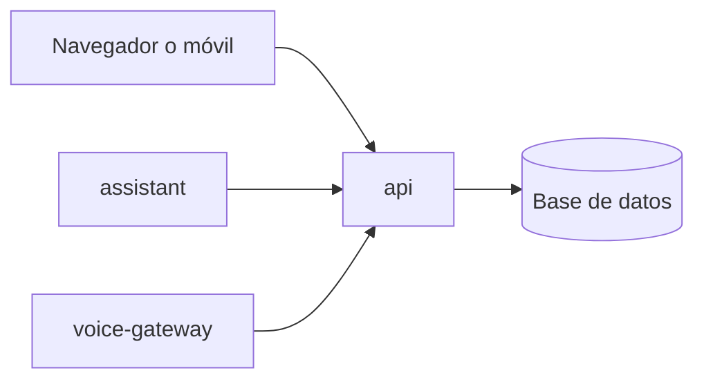

# Arquitectura

## Las piezas

Domus son tres programas, y cada uno corre en su propio contenedor: una caja aislada con lo justo para funcionar, que se arranca y se para por separado. Si uno se cae, los otros dos siguen a lo suyo.

api es la puerta. Es el único programa al que se llega desde fuera, el único que guarda datos y el que entrega la web al navegador. assistant es el programa de Kira y voice-gateway, el de la voz. Ninguno de los dos puede leer los datos por su cuenta: si necesitan algo, se lo piden a api como lo haría cualquier otro.

La web no es un programa aparte, sino una página que sirve api.

## Las capas

Por dentro, el código está repartido en tres capas. La plataforma es lo que comparten todos: la puerta, la base de datos y la forma de ponerla al día. Los módulos son las partes de la vida de casa, cada una con sus propias tablas. Y los programas juntan las dos cosas y las ponen en marcha, sin decidir nada por sí mismos.

Esto no depende de que nadie se acuerde. Unas reglas impiden, por ejemplo, que un módulo use la plataforma por donde no debe, y se comprueban solas en cada cambio.

## En el código

| Carpeta                          | Qué hay                                                                      | Tema                                         |
| -------------------------------- | ---------------------------------------------------------------------------- | -------------------------------------------- |
| `apps/api`                       | El programa api: abre la plataforma con la lista de módulos y sirve la web   | [Programas](programas.md)                    |
| `apps/assistant`                 | El programa assistant                                                        | [Programas](programas.md)                    |
| `apps/voice-gateway`             | El programa voice-gateway                                                    | [Programas](programas.md)                    |
| `apps/web`                       | La web, en Vue                                                               | [Programas](programas.md)                    |
| `modules/probe`                  | El módulo de prueba                                                          | [Módulos](modulos.md)                        |
| `packages/platform`              | La plataforma: la puerta (`http`), sus contratos y la base de datos          | [Programas](programas.md), [Datos](datos.md) |
| `packages/module-sdk`            | Lo único de la plataforma que puede usar un módulo                           | [Módulos](modulos.md)                        |
| `packages/test-utils`            | Una plataforma real para las pruebas                                         | [Cómo se construye](como-se-construye.md)    |
| `packages/api-client`            | El cliente con el que un programa habla con api                              | [Programas](programas.md)                    |
| `packages/utils`                 | Utilidades sin nada del negocio: `connection` y `program`                    | [Programas](programas.md)                    |
| `packages/ui`, `packages/i18n`   | Paquetes vacíos                                                              |                                              |
| `tooling/scripts`                | Los generadores y las comprobaciones del repositorio                         | [Cómo se construye](como-se-construye.md)    |
| `tooling/typescript`             | La configuración de TypeScript que comparten todos                           | [Cómo se construye](como-se-construye.md)    |
| `docker/`, `docker-compose.yml`  | Cómo se construyen y se arrancan los contenedores                            | [La Pi](la-pi.md)                            |
| `.github/workflows`, `.githooks` | Las comprobaciones de cada cambio, en GitHub y antes de cada commit          | [Cómo se construye](como-se-construye.md)    |
| `.scratch/`                      | Las especificaciones y tareas de cada fase                                   | [Cómo se construye](como-se-construye.md)    |
| `docs/`                          | Esta guía, la arquitectura con sus decisiones (ADR), el plan y el despliegue |                                              |
| `AGENTS.md`, `CLAUDE.md`         | Las instrucciones para los agentes, una por carpeta grande                   | [Cómo se construye](como-se-construye.md)    |

Decisiones: [ADR 0003](../architecture/adr/0003-procesos-y-contenedores.md) (procesos y contenedores), [ADR 0004](../architecture/adr/0004-una-sola-puerta.md) (una sola puerta), [ADR 0017](../architecture/adr/0017-estructura-del-repositorio.md) (estructura del repositorio) y [ADR 0020](../architecture/adr/0020-composicion-de-la-api-y-comunicacion-entre-procesos.md) (cómo se compone api y cómo hablan los programas).
