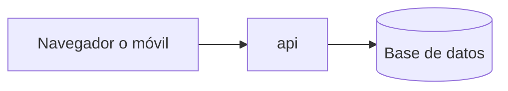

# Arquitectura

## Las piezas

Domus es un solo programa, api, que corre en su propio contenedor: una caja aislada con lo justo para funcionar, que se arranca, se para y se reconstruye sin tocar los datos.

api es la puerta. Es lo único a lo que se llega desde fuera, lo único que guarda datos y lo que entrega la web al navegador. La web no es un programa aparte, sino una página que sirve api.

## Las capas

Por dentro, el código está repartido en tres capas. La plataforma es lo que comparten todos: la puerta, las cuentas, la base de datos con la forma de ponerla al día y sus copias de seguridad, los archivos, el canal en directo y los avisos, la decisión de qué puede hacer cada uno y el camino por el que pasa cada acción, con su registro. Los módulos son las partes de la vida de casa, cada una con sus propias tablas y sus acciones, que son la única forma de tocarlas. Y api junta las dos cosas y las pone en marcha, sin decidir nada por sí mismo.

Esto no depende de que nadie se acuerde. Unas reglas impiden, por ejemplo, que un módulo use la plataforma por donde no debe, y se comprueban solas en cada cambio.

## En el código

| Carpeta                          | Qué hay                                                                                                                                                                                                                                   | Tema                                                                                                                                                                                                                                                  |
| -------------------------------- | ----------------------------------------------------------------------------------------------------------------------------------------------------------------------------------------------------------------------------------------- | ----------------------------------------------------------------------------------------------------------------------------------------------------------------------------------------------------------------------------------------------------- |
| `apps/api`                       | El programa api: abre la plataforma con la lista de módulos y sirve la web                                                                                                                                                                | [Programas](programas.md), [Segundo plano](segundo-plano.md)                                                                                                                                                                                          |
| `apps/web`                       | La web, en Vue                                                                                                                                                                                                                            | [Programas](programas.md)                                                                                                                                                                                                                             |
| `modules/probe`                  | El módulo de prueba                                                                                                                                                                                                                       | [Módulos](modulos.md)                                                                                                                                                                                                                                 |
| `packages/platform`              | La plataforma: la puerta (`http`), cuentas (`identity`), permisos (`authorization`), datos, acciones, archivos (`files`), segundo plano (`background`), copias (`backups`), el canal en directo (`events`) y los avisos (`notifications`) | [Programas](programas.md), [Cuentas](cuentas.md), [Permisos](permisos.md), [Datos](datos.md), [Acciones](acciones.md), [Archivos](archivos.md), [Segundo plano](segundo-plano.md), [Copias](copias.md), [En directo y avisos](en-directo-y-avisos.md) |
| `packages/module-sdk`            | Lo único de la plataforma que puede usar un módulo                                                                                                                                                                                        | [Módulos](modulos.md)                                                                                                                                                                                                                                 |
| `packages/test-utils`            | Una plataforma real para las pruebas, con reloj, cuentas y sesiones que preparan ellas                                                                                                                                                    | [Cómo se construye](como-se-construye.md)                                                                                                                                                                                                             |
| `packages/api-client`            | El cliente con el que se habla con api                                                                                                                                                                                                    | [Programas](programas.md)                                                                                                                                                                                                                             |
| `packages/utils`                 | Utilidades sin nada del negocio: `program` y `date-time`                                                                                                                                                                                  | [Programas](programas.md), [Segundo plano](segundo-plano.md)                                                                                                                                                                                          |
| `packages/ui`, `packages/i18n`   | Paquetes vacíos                                                                                                                                                                                                                           |                                                                                                                                                                                                                                                       |
| `tooling/scripts`                | Los generadores y las comprobaciones del repositorio                                                                                                                                                                                      | [Cómo se construye](como-se-construye.md)                                                                                                                                                                                                             |
| `tooling/typescript`             | La configuración de TypeScript que comparten todos                                                                                                                                                                                        | [Cómo se construye](como-se-construye.md)                                                                                                                                                                                                             |
| `docker/`, `docker-compose.yml`  | Cómo se construye y se arranca el contenedor, y el ensayo de restaurar (`docker/ensayo`)                                                                                                                                                  | [La Pi](la-pi.md), [Copias](copias.md)                                                                                                                                                                                                                |
| `.github/workflows`, `.githooks` | Las comprobaciones de cada cambio, en GitHub y antes de cada commit                                                                                                                                                                       | [Cómo se construye](como-se-construye.md)                                                                                                                                                                                                             |
| `.scratch/`                      | Las especificaciones y tareas de cada fase                                                                                                                                                                                                | [Cómo se construye](como-se-construye.md)                                                                                                                                                                                                             |
| `docs/`                          | Esta guía, la arquitectura con sus decisiones (ADR), el plan y el despliegue                                                                                                                                                              |                                                                                                                                                                                                                                                       |
| `AGENTS.md`, `CLAUDE.md`         | Las instrucciones para los agentes, una por carpeta grande                                                                                                                                                                                | [Cómo se construye](como-se-construye.md)                                                                                                                                                                                                             |

Decisiones: [ADR 0003](../architecture/adr/0003-procesos-y-contenedores.md) (procesos y contenedores), [ADR 0004](../architecture/adr/0004-una-sola-puerta.md) (una sola puerta), [ADR 0017](../architecture/adr/0017-estructura-del-repositorio.md) (estructura del repositorio), [ADR 0020](../architecture/adr/0020-composicion-de-la-api-y-comunicacion-entre-procesos.md) (cómo se compone api), [ADR 0022](../architecture/adr/0022-acciones.md) (acciones), [ADR 0023](../architecture/adr/0023-identidad-y-autorizacion.md) (identidad y autorización) y [ADR 0034](../architecture/adr/0034-retirar-las-apps-conectadas-antes-de-la-fase-5.md) (un solo programa).
